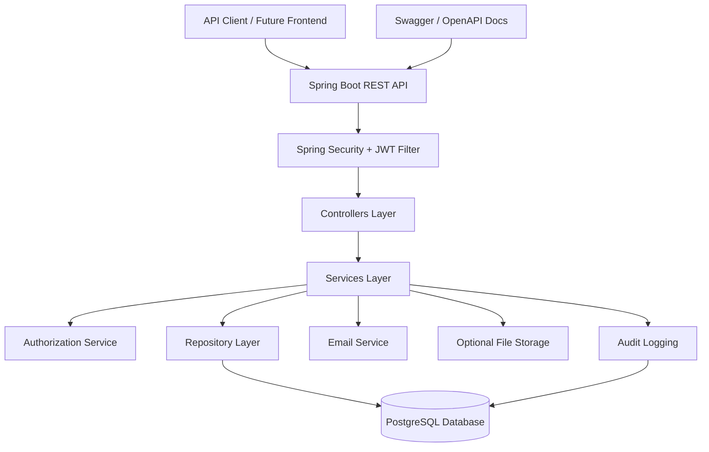
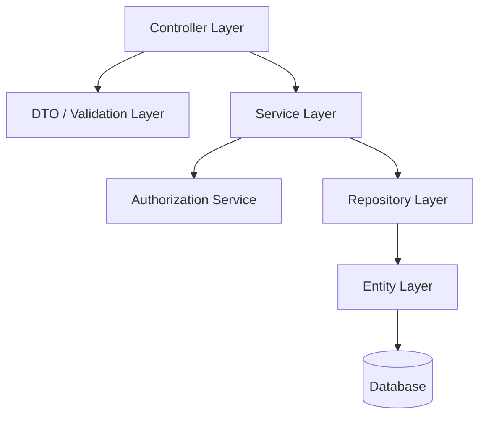
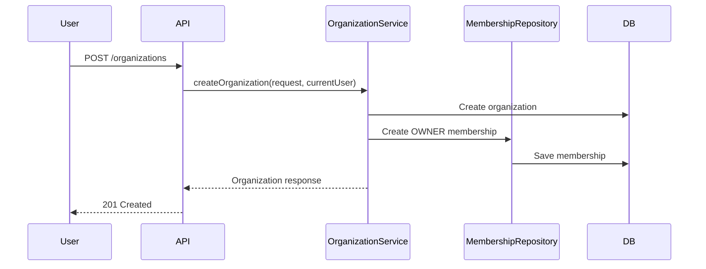
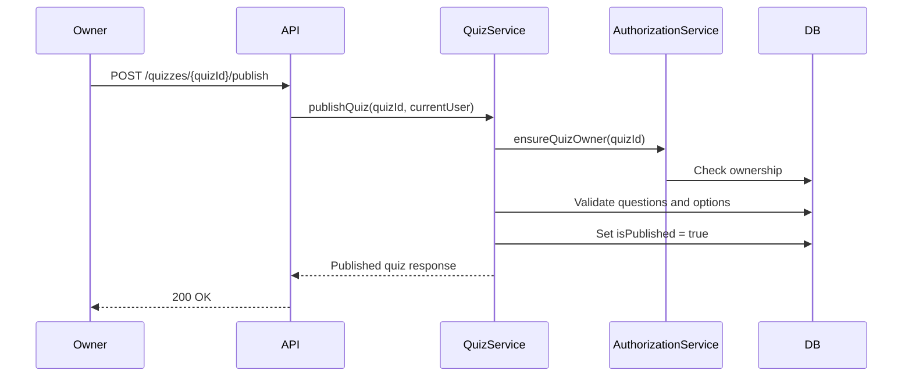
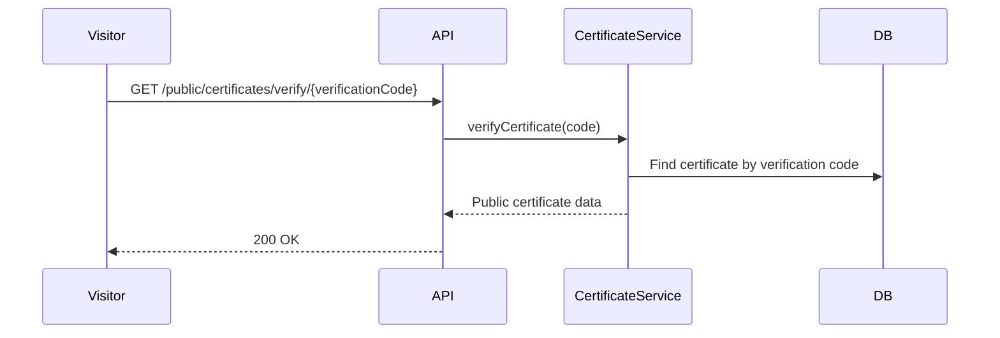
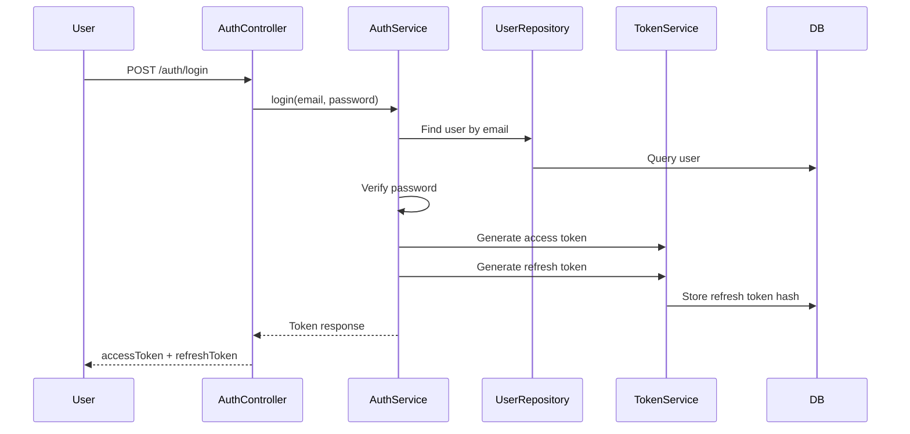
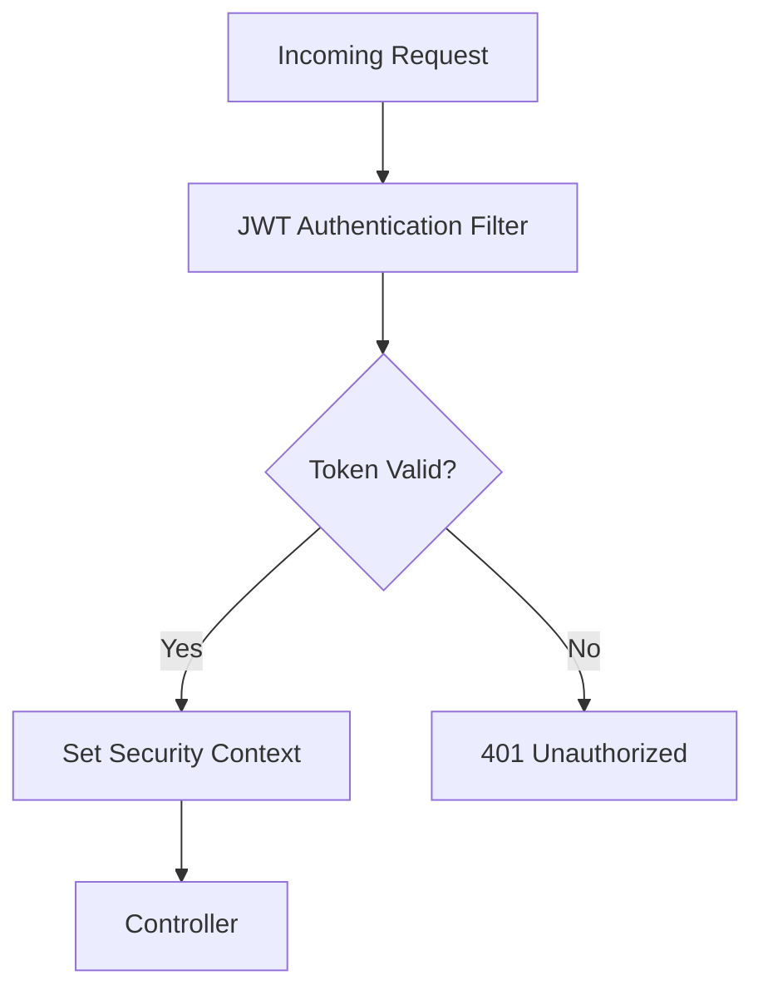
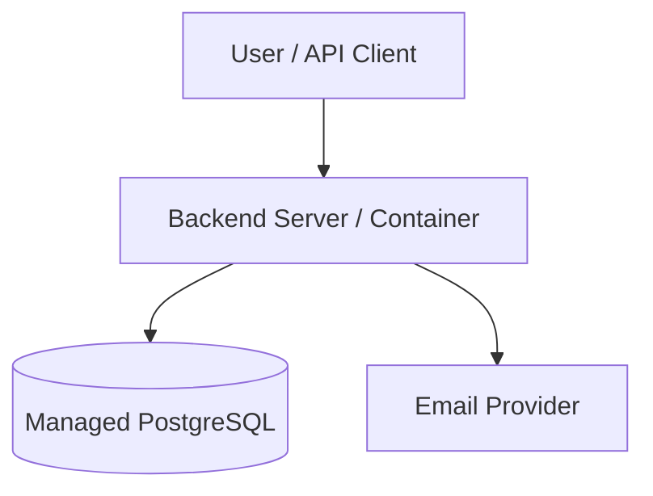

# Skillmark Architecture

## 1. Overview

This document defines the backend architecture for **Skillmark**, an API-first quiz and certification platform.

Skillmark allows organizations such as universities, student clubs, training centers, and technical communities to create quizzes, manage participants, evaluate quiz attempts, and issue verifiable certificates.

The current phase is focused on the **backend API only**. Frontend, mobile apps, dashboards, and full LMS features are outside the current MVP scope.

---

## 2. Architecture Goals

The architecture should be:

- simple enough for an MVP
- clean enough for future expansion
- secure by default
- easy to test
- easy to deploy
- suitable for multi-tenant organization-based access
- based on clear separation of concerns

The system should avoid unnecessary microservices in the MVP.

Recommended architecture style:

```text
Modular Monolith + REST API + PostgreSQL + JWT Authentication
```

---

## 3. High-Level Architecture



---

## 4. Main System Components

## 4.1 API Client

The API client can be:

- Swagger UI
- Postman
- future web dashboard
- future student portal
- future mobile app

The backend should not depend on a specific frontend.

---

## 4.2 Backend API

The backend exposes REST endpoints under:

```text
/api/v1
```

Responsibilities:

- receive HTTP requests
- validate request body and parameters
- authenticate requests
- authorize access
- call service layer
- return consistent API responses
- expose OpenAPI documentation

Recommended technology:

- Java 17+
- Spring Boot
- Spring Web
- Spring Security
- Spring Data JPA
- PostgreSQL
- Flyway

---

## 4.3 Database

Recommended database:

```text
PostgreSQL
```

The database stores:

- users
- organizations
- organization memberships
- quizzes
- questions
- options
- attempts
- attempt answers
- certificates
- refresh tokens
- email verification tokens
- password reset tokens
- audit logs

The database must enforce important constraints such as:

- unique user email
- unique organization membership per user and organization
- unique certificate number
- unique certificate verification code
- only one active certificate per user and quiz

---

## 4.4 Authentication Layer

The authentication layer handles:

- registration
- login
- password hashing
- JWT access tokens
- refresh tokens
- logout
- email verification
- password reset

Recommended approach:

- access token: short-lived JWT
- refresh token: long-lived random token stored as hash
- password: stored using BCrypt
- reset and verification tokens: stored as hashes

---

## 4.5 Authorization Layer

Skillmark uses **organization-scoped authorization**.

The system must not depend on a global user role such as:

```text
users.role = OWNER
```

Instead, business permissions are based on:

```text
organization_memberships
```

Example checks:

```text
ensureOrganizationOwner(organizationId)
ensureOrganizationMember(organizationId)
ensureActiveParticipantMember(organizationId, userId)
ensureQuizOwner(quizId)
ensureQuizAccessible(quizId)
ensureAttemptOwner(attemptId)
ensureCertificateAccessible(certificateId)
```

These checks should be centralized in an `AuthorizationService`.

---

## 5. Layered Architecture



---

# 5.1 Controller Layer

Controllers should be thin.

Responsibilities:

- define REST endpoints
- receive requests
- validate DTOs
- extract authenticated user if needed
- call service methods
- return standardized responses

Controllers should not contain business rules.

Example controller responsibilities:

```text
POST /api/v1/quizzes
GET /api/v1/quizzes/{quizId}
POST /api/v1/quizzes/{quizId}/attempts
POST /api/v1/quiz-attempts/{attemptId}/submit
```

---

# 5.2 DTO and Validation Layer

DTOs should be used for request and response objects.

Request DTOs should validate:

- required fields
- email format
- password length
- positive numeric values
- valid enum values
- quiz settings
- question and option structure

Example:

```java
public record CreateQuizRequest(
    @NotBlank String title,
    String description,
    @NotNull UUID organizationId,
    @Min(0) @Max(100) Integer passingScore,
    @Min(1) Integer durationMinutes,
    @Min(1) Integer maxAttempts,
    Boolean certificateEnabled,
    CertificateIssueMode certificateIssueMode
) {}
```

---

# 5.3 Service Layer

The service layer contains business rules.

Responsibilities:

- enforce authorization
- apply business validation
- manage transactions
- calculate quiz scores
- issue certificates
- revoke certificates
- create audit logs
- coordinate repositories

Example services:

- `AuthService`
- `UserService`
- `OrganizationService`
- `MembershipService`
- `QuizService`
- `QuizQuestionService`
- `QuizAttemptService`
- `CertificateService`
- `AuditLogService`

---

# 5.4 Repository Layer

Repositories handle database access.

Responsibilities:

- query entities
- save entities
- check existence
- fetch paginated lists
- enforce query-level filtering where helpful

Recommended technology:

```text
Spring Data JPA
```

Example repositories:

- `UserRepository`
- `OrganizationRepository`
- `OrganizationMembershipRepository`
- `QuizRepository`
- `QuizQuestionRepository`
- `QuizOptionRepository`
- `QuizAttemptRepository`
- `CertificateRepository`

---

# 5.5 Entity Layer

Entities map to database tables.

Entities should represent persisted data, not request/response formats.

Examples:

- `User`
- `Organization`
- `OrganizationMembership`
- `Quiz`
- `QuizQuestion`
- `QuizOption`
- `QuizAttempt`
- `QuizAttemptAnswer`
- `Certificate`
- `RefreshToken`
- `AuditLog`

---

## 6. Recommended Backend Modules

```text
src/main/java/com/Skillmark
│
├── auth
│   ├── controller
│   ├── dto
│   ├── entity
│   ├── repository
│   └── service
│
├── user
│   ├── controller
│   ├── dto
│   ├── entity
│   ├── repository
│   └── service
│
├── organization
│   ├── controller
│   ├── dto
│   ├── entity
│   ├── repository
│   └── service
│
├── membership
│   ├── controller
│   ├── dto
│   ├── entity
│   ├── repository
│   └── service
│
├── quiz
│   ├── controller
│   ├── dto
│   ├── entity
│   ├── repository
│   └── service
│
├── attempt
│   ├── controller
│   ├── dto
│   ├── entity
│   ├── repository
│   └── service
│
├── certificate
│   ├── controller
│   ├── dto
│   ├── entity
│   ├── repository
│   └── service
│
├── audit
│   ├── entity
│   ├── repository
│   └── service
│
├── common
│   ├── dto
│   ├── exception
│   ├── response
│   └── util
│
├── security
│   ├── jwt
│   ├── filter
│   ├── config
│   └── service
│
└── config
```

---

## 7. Core Domain Flow

## 7.1 Organization Creation Flow



Rules:

- any authenticated user can create an organization
- creator becomes owner
- owner membership must be created immediately

---

## 7.2 Quiz Publishing Flow



Rules:

- only organization owner can publish
- quiz must contain valid questions
- every single-choice question must have exactly one correct option

---

## 7.3 Quiz Attempt Submission Flow

```mermaid
sequenceDiagram
    participant Participant
    participant API
    participant AttemptService
    participant AuthorizationService
    participant CertificateService
    participant DB

    Participant->>API: POST /quiz-attempts/{attemptId}/submit
    API->>AttemptService: submitAttempt(attemptId, answers, currentUser)
    AttemptService->>AuthorizationService: ensureAttemptOwner(attemptId)
    AuthorizationService->>DB: Check attempt owner
    AttemptService->>DB: Validate answers
    AttemptService->>DB: Calculate score
    AttemptService->>DB: Save attempt answers and result
    AttemptService->>CertificateService: issue automatically if passed and AUTO
    CertificateService->>DB: Create certificate if eligible
    AttemptService-->>API: Attempt result
    API-->>Participant: 200 OK
```

Rules:

- participant can submit only their own attempt
- already submitted attempts cannot be submitted again
- answers must belong to the same quiz
- score is calculated by the backend
- certificate may be issued automatically if enabled

---

## 7.4 Certificate Verification Flow



Rules:

- verification endpoint is public
- response must not expose sensitive user data
- revoked certificates should still be visible as revoked

---

## 8. Security Architecture

## 8.1 Authentication Flow



---

## 8.2 JWT Request Flow



---

## 8.3 Authorization Rules

Authorization must be checked for every protected organization resource.

Examples:

| Action | Required Permission |
|---|---|
| Update organization | OWNER of organization |
| Add member | OWNER of organization |
| Create quiz | OWNER of organization |
| Publish quiz | OWNER of quiz organization |
| View published quiz | ACTIVE member of organization |
| Start attempt | ACTIVE PARTICIPANT of organization |
| Submit attempt | Attempt owner |
| View all quiz attempts | OWNER of quiz organization |
| Issue certificate | OWNER of quiz organization |
| Revoke certificate | OWNER of certificate organization |
| Public certificate verification | Public access |

---

## 9. Transaction Boundaries

Use transactions for operations that update multiple tables.

Recommended transactional operations:

- register user
- create organization and owner membership
- add organization member
- create quiz with questions/options if done in one request
- publish quiz
- start quiz attempt
- submit quiz attempt and answers
- auto issue certificate after passing
- manual certificate issuing
- revoke certificate
- password reset
- logout / revoke refresh token

Example:

```java
@Transactional
public SubmitAttemptResponse submitAttempt(UUID attemptId, SubmitAttemptRequest request) {
    // validate ownership
    // validate answers
    // calculate score
    // save answers
    // update attempt
    // issue certificate if needed
}
```

---

## 10. Error Handling Architecture

The backend should use a global exception handler.

Recommended exceptions:

- `ResourceNotFoundException`
- `UnauthorizedException`
- `ForbiddenException`
- `ValidationException`
- `BusinessRuleException`
- `DuplicateResourceException`
- `InvalidTokenException`

All error responses should follow a consistent format:

```json
{
  "success": false,
  "message": "Validation failed",
  "errors": [
    {
      "field": "email",
      "message": "Email is required"
    }
  ],
  "timestamp": "2026-05-24T15:00:00Z",
  "path": "/api/v1/auth/register"
}
```

---

## 11. API Response Architecture

Success response:

```json
{
  "success": true,
  "message": "Operation successful",
  "data": {}
}
```

Paginated response:

```json
{
  "success": true,
  "message": "Data retrieved successfully",
  "data": {
    "items": [],
    "page": 0,
    "size": 10,
    "totalElements": 100,
    "totalPages": 10
  }
}
```

---

## 12. Audit Logging Architecture

Audit logs should be created for important actions.

Examples:

- organization created
- organization updated
- member added
- member removed
- quiz created
- quiz published
- attempt submitted
- certificate issued
- certificate revoked
- login failed
- password reset completed

Audit metadata should not include:

- plaintext passwords
- raw tokens
- secrets
- sensitive personal data beyond what is needed

---

## 13. Deployment Architecture

Recommended MVP deployment:



Recommended deployment options:

- Docker container
- cloud VM
- Render
- Railway
- DigitalOcean App Platform
- AWS Elastic Beanstalk
- any managed container service

Recommended database providers:

- Neon
- Supabase
- AWS RDS
- DigitalOcean Managed PostgreSQL

---

## 14. Environment Configuration

Use environment variables for configuration.

Example variables:

```env
APP_ENV=development
SERVER_PORT=8080
DATABASE_URL=jdbc:postgresql://localhost:5432/Skillmark
DATABASE_USERNAME=postgres
DATABASE_PASSWORD=password
JWT_SECRET=change-this-secret
JWT_ACCESS_TOKEN_EXPIRATION_MINUTES=15
JWT_REFRESH_TOKEN_EXPIRATION_DAYS=30
CORS_ALLOWED_ORIGINS=http://localhost:5173
MAIL_HOST=smtp.example.com
MAIL_PORT=587
MAIL_USERNAME=example
MAIL_PASSWORD=example
```

Secrets must not be committed to GitHub.

---

## 15. Scalability Strategy

For the MVP, a modular monolith is enough.

Future scalability can be achieved by:

- adding database indexes
- using pagination on all list endpoints
- caching public certificate verification if needed
- moving file storage to external provider
- adding background jobs for emails and PDF generation
- splitting modules only if the system grows significantly

Avoid microservices in the first version unless there is a real need.

---

## 16. Future Architecture Extensions

Future versions may add:

- frontend dashboard
- student portal
- invitation system
- bulk member import
- certificate PDF generation
- QR code generation
- analytics module
- notification module
- advanced question bank
- external file storage
- background job queue
- role expansion such as INSTRUCTOR and MANAGER

---

## 17. Final Architecture Decision

Skillmark should be built as a **secure modular monolith** using Spring Boot and PostgreSQL.

The most important architectural decision is that the system uses **organization-scoped authorization**, not global user roles.

This keeps the system flexible for university use cases where the same user may be an owner in one organization and a participant in another.
