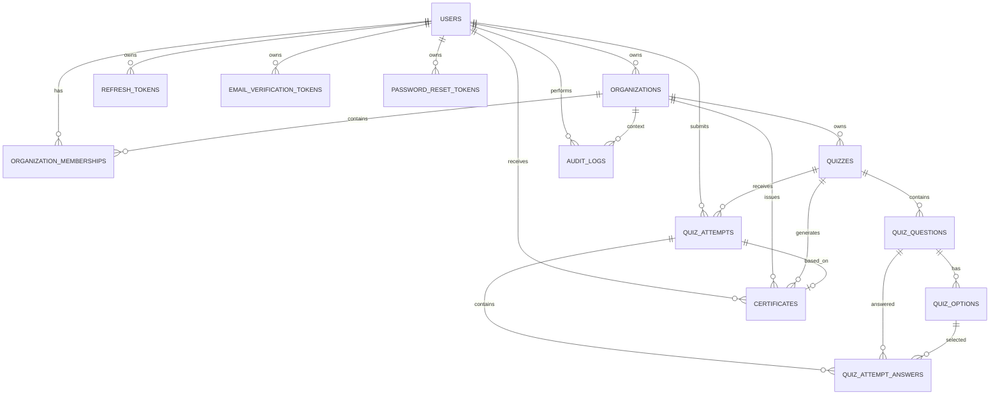

# Skillmark Database Design

## 1. Overview

This document defines the database design for **Skillmark**, an API-first quiz and certification backend.

Skillmark uses a **multi-tenant organization-based model**. Users do not have global business roles such as `OWNER` or `PARTICIPANT`. Instead, permissions are controlled through the `organization_memberships` table.

A single user can be:

- owner of one organization
- participant in another organization
- participant in multiple organizations
- owner of multiple organizations

The database is designed for a backend MVP focused on:

- authentication
- organizations
- memberships
- quizzes
- quiz attempts
- certificates
- certificate verification
- audit logging

Recommended database: **PostgreSQL**.

---

## 2. Main Design Principles

### 2.1 No Global Business Role on User

The `users` table must not contain a global role such as:

```text
OWNER
PARTICIPANT
STUDENT
ADMIN
```

Business permissions are organization-scoped and stored in:

```text
organization_memberships
```

---

### 2.2 Multi-Tenant Isolation

All organization-related data must be connected to an organization either directly or indirectly.

Examples:

- A quiz belongs to an organization.
- A certificate belongs to an organization.
- A participant accesses quizzes only through active organization membership.

---

### 2.3 Preserve Historical Records

Important historical data should not be lost when names or statuses change.

Certificates store snapshot fields such as:

- participant name at issue time
- quiz title at issue time
- organization name at issue time

Soft deletion or status-based disabling is preferred for organizations and quizzes.

---

## 3. Entity Relationship Diagram



---

## 4. Enums

## 4.1 UserStatus

```text
ACTIVE
DISABLED
DELETED
```

---

## 4.2 OrganizationStatus

```text
ACTIVE
DISABLED
DELETED
```

---

## 4.3 MembershipRole

```text
OWNER
PARTICIPANT
```

Future roles:

```text
INSTRUCTOR
MANAGER
REVIEWER
```

---

## 4.4 MembershipStatus

```text
ACTIVE
INACTIVE
REMOVED
```

---

## 4.5 QuizStatus

```text
DRAFT
PUBLISHED
ARCHIVED
DELETED
```

---

## 4.6 QuestionType

```text
SINGLE_CHOICE
```

Future question types:

```text
MULTIPLE_CHOICE
TRUE_FALSE
TEXT
```

---

## 4.7 AttemptStatus

```text
IN_PROGRESS
SUBMITTED
EXPIRED
CANCELLED
```

---

## 4.8 CertificateIssueMode

```text
AUTO
MANUAL
NONE
```

---

## 4.9 CertificateStatus

```text
ACTIVE
REVOKED
```

---

## 5. Tables

---

# 5.1 users

## Purpose

Stores account identities.

A user is not globally an owner or participant. Organization-specific permissions are stored in `organization_memberships`.

## Columns

| Column | Type | Constraints | Description |
|---|---|---|---|
| id | UUID | PK | User ID |
| name | VARCHAR(150) | NOT NULL | User full name |
| email | VARCHAR(255) | NOT NULL, UNIQUE | User email |
| password_hash | VARCHAR(255) | NOT NULL | Hashed password |
| email_verified | BOOLEAN | NOT NULL DEFAULT false | Email verification state |
| status | VARCHAR(30) | NOT NULL DEFAULT 'ACTIVE' | User status |
| created_at | TIMESTAMP | NOT NULL | Creation time |
| updated_at | TIMESTAMP | NOT NULL | Last update time |

## Notes

Do not expose `password_hash` in API responses.

---

# 5.2 organizations

## Purpose

Stores organizations that own quizzes and certificates.

Examples:

- Computer Science Club
- AI Training Program
- University Department
- Internship Program

## Columns

| Column | Type | Constraints | Description |
|---|---|---|---|
| id | UUID | PK | Organization ID |
| name | VARCHAR(200) | NOT NULL | Organization name |
| description | TEXT | NULL | Optional description |
| owner_id | UUID | FK users(id), NOT NULL | Main owner user |
| status | VARCHAR(30) | NOT NULL DEFAULT 'ACTIVE' | Organization status |
| created_at | TIMESTAMP | NOT NULL | Creation time |
| updated_at | TIMESTAMP | NOT NULL | Last update time |
| deleted_at | TIMESTAMP | NULL | Soft delete timestamp |

## Important Rule

When an organization is created:

1. A row is inserted into `organizations`.
2. A row is inserted into `organization_memberships` with role `OWNER`.

---

# 5.3 organization_memberships

## Purpose

Stores the role of a user inside an organization.

This is the main authorization table for business permissions.

## Columns

| Column | Type | Constraints | Description |
|---|---|---|---|
| id | UUID | PK | Membership ID |
| organization_id | UUID | FK organizations(id), NOT NULL | Organization ID |
| user_id | UUID | FK users(id), NOT NULL | User ID |
| role | VARCHAR(30) | NOT NULL | OWNER or PARTICIPANT |
| status | VARCHAR(30) | NOT NULL DEFAULT 'ACTIVE' | Membership status |
| created_at | TIMESTAMP | NOT NULL | Creation time |
| updated_at | TIMESTAMP | NOT NULL | Last update time |

## Constraints

```text
UNIQUE (organization_id, user_id)
```

This prevents duplicate membership records for the same user in the same organization.

## Notes

A user can be OWNER in one organization and PARTICIPANT in another.

---

# 5.4 quizzes

## Purpose

Stores quizzes created inside organizations.

A quiz belongs directly to an organization.

## Columns

| Column | Type | Constraints | Description |
|---|---|---|---|
| id | UUID | PK | Quiz ID |
| organization_id | UUID | FK organizations(id), NOT NULL | Owner organization |
| title | VARCHAR(255) | NOT NULL | Quiz title |
| description | TEXT | NULL | Quiz description |
| passing_score | DECIMAL(5,2) | NOT NULL | Required percentage to pass |
| duration_minutes | INT | NULL | Quiz duration in minutes |
| max_attempts | INT | NOT NULL DEFAULT 1 | Maximum allowed attempts |
| certificate_enabled | BOOLEAN | NOT NULL DEFAULT false | Whether quiz can issue certificates |
| certificate_issue_mode | VARCHAR(30) | NOT NULL DEFAULT 'NONE' | AUTO, MANUAL, or NONE |
| is_published | BOOLEAN | NOT NULL DEFAULT false | Publication state |
| status | VARCHAR(30) | NOT NULL DEFAULT 'DRAFT' | Quiz status |
| created_at | TIMESTAMP | NOT NULL | Creation time |
| updated_at | TIMESTAMP | NOT NULL | Last update time |
| deleted_at | TIMESTAMP | NULL | Soft delete timestamp |

## Validation Rules

- `passing_score` must be between 0 and 100.
- `max_attempts` must be greater than 0.
- `certificate_issue_mode` must be `NONE` if `certificate_enabled = false`.

---

# 5.5 quiz_questions

## Purpose

Stores questions inside quizzes.

Current MVP supports only `SINGLE_CHOICE` questions.

## Columns

| Column | Type | Constraints | Description |
|---|---|---|---|
| id | UUID | PK | Question ID |
| quiz_id | UUID | FK quizzes(id), NOT NULL | Parent quiz |
| text | TEXT | NOT NULL | Question text |
| type | VARCHAR(30) | NOT NULL DEFAULT 'SINGLE_CHOICE' | Question type |
| points | DECIMAL(8,2) | NOT NULL DEFAULT 1 | Question points |
| position | INT | NOT NULL | Question order |
| created_at | TIMESTAMP | NOT NULL | Creation time |
| updated_at | TIMESTAMP | NOT NULL | Last update time |

## Constraints

```text
UNIQUE (quiz_id, position)
```

---

# 5.6 quiz_options

## Purpose

Stores answer options for quiz questions.

For `SINGLE_CHOICE`, each question must have exactly one correct option.

## Columns

| Column | Type | Constraints | Description |
|---|---|---|---|
| id | UUID | PK | Option ID |
| question_id | UUID | FK quiz_questions(id), NOT NULL | Parent question |
| text | TEXT | NOT NULL | Option text |
| is_correct | BOOLEAN | NOT NULL DEFAULT false | Correct answer flag |
| position | INT | NOT NULL | Option order |
| created_at | TIMESTAMP | NOT NULL | Creation time |
| updated_at | TIMESTAMP | NOT NULL | Last update time |

## Constraints

```text
UNIQUE (question_id, position)
```

## Business Rule

For every `SINGLE_CHOICE` question, exactly one option must have:

```text
is_correct = true
```

This rule is usually enforced in service logic.

---

# 5.7 quiz_attempts

## Purpose

Stores user attempts for quizzes.

## Columns

| Column | Type | Constraints | Description |
|---|---|---|---|
| id | UUID | PK | Attempt ID |
| quiz_id | UUID | FK quizzes(id), NOT NULL | Quiz ID |
| user_id | UUID | FK users(id), NOT NULL | Participant user |
| score | DECIMAL(8,2) | NULL | Total awarded points or percentage |
| score_percentage | DECIMAL(5,2) | NULL | Percentage score |
| passed | BOOLEAN | NULL | Pass/fail result |
| status | VARCHAR(30) | NOT NULL DEFAULT 'IN_PROGRESS' | Attempt status |
| started_at | TIMESTAMP | NOT NULL | Attempt start time |
| submitted_at | TIMESTAMP | NULL | Submission time |
| created_at | TIMESTAMP | NOT NULL | Creation time |
| updated_at | TIMESTAMP | NOT NULL | Last update time |

## Business Rules

- A user can only start an attempt if they are an active participant in the quiz organization.
- The quiz must be published.
- The quiz must not be archived or deleted.
- The user must not exceed `max_attempts`.
- A submitted attempt cannot be submitted again.

---

# 5.8 quiz_attempt_answers

## Purpose

Stores submitted answers for quiz attempts.

## Columns

| Column | Type | Constraints | Description |
|---|---|---|---|
| id | UUID | PK | Attempt answer ID |
| attempt_id | UUID | FK quiz_attempts(id), NOT NULL | Attempt ID |
| question_id | UUID | FK quiz_questions(id), NOT NULL | Question ID |
| selected_option_id | UUID | FK quiz_options(id), NOT NULL | Selected option |
| is_correct | BOOLEAN | NOT NULL | Whether answer is correct |
| points_awarded | DECIMAL(8,2) | NOT NULL DEFAULT 0 | Awarded points |
| created_at | TIMESTAMP | NOT NULL | Creation time |

## Constraints

```text
UNIQUE (attempt_id, question_id)
```

## Business Rules

- `question_id` must belong to the same quiz as the attempt.
- `selected_option_id` must belong to the same question.
- A user cannot submit answers to another user's attempt.

---

# 5.9 certificates

## Purpose

Stores certificates issued to users after passing quizzes.

Certificates can be publicly verified using `verification_code`.

## Columns

| Column | Type | Constraints | Description |
|---|---|---|---|
| id | UUID | PK | Certificate ID |
| certificate_number | VARCHAR(100) | NOT NULL, UNIQUE | Human-readable certificate number |
| verification_code | VARCHAR(150) | NOT NULL, UNIQUE | Public verification code |
| organization_id | UUID | FK organizations(id), NOT NULL | Issuing organization |
| quiz_id | UUID | FK quizzes(id), NOT NULL | Related quiz |
| user_id | UUID | FK users(id), NOT NULL | Certificate owner |
| attempt_id | UUID | FK quiz_attempts(id), NOT NULL | Passing attempt |
| title | VARCHAR(255) | NOT NULL | Certificate title |
| participant_name_snapshot | VARCHAR(150) | NOT NULL | User name at issue time |
| quiz_title_snapshot | VARCHAR(255) | NOT NULL | Quiz title at issue time |
| organization_name_snapshot | VARCHAR(200) | NOT NULL | Organization name at issue time |
| status | VARCHAR(30) | NOT NULL DEFAULT 'ACTIVE' | Certificate status |
| issued_at | TIMESTAMP | NOT NULL | Issue time |
| revoked_at | TIMESTAMP | NULL | Revocation time |
| revoke_reason | TEXT | NULL | Reason for revocation |
| pdf_url | TEXT | NULL | Future PDF file URL |
| created_at | TIMESTAMP | NOT NULL | Creation time |
| updated_at | TIMESTAMP | NOT NULL | Last update time |

## Suggested Constraint

To prevent duplicate active certificates, use service-level validation or a partial unique index:

```sql
CREATE UNIQUE INDEX uq_active_certificate_per_user_quiz
ON certificates (quiz_id, user_id)
WHERE status = 'ACTIVE';
```

## Certificate Eligibility Rules

A certificate can be issued only if:

- user exists
- user is an ACTIVE PARTICIPANT in the quiz organization
- attempt belongs to the same user
- attempt belongs to the same quiz
- attempt is submitted
- attempt is passed
- no active certificate already exists for the same quiz and user

---

# 5.10 refresh_tokens

## Purpose

Stores hashed refresh tokens for user sessions.

## Columns

| Column | Type | Constraints | Description |
|---|---|---|---|
| id | UUID | PK | Refresh token ID |
| user_id | UUID | FK users(id), NOT NULL | User owner |
| token_hash | VARCHAR(255) | NOT NULL, UNIQUE | Hashed refresh token |
| expires_at | TIMESTAMP | NOT NULL | Expiration time |
| revoked_at | TIMESTAMP | NULL | Revocation time |
| created_at | TIMESTAMP | NOT NULL | Creation time |

## Notes

Never store raw refresh tokens.

---

# 5.11 email_verification_tokens

## Purpose

Stores hashed email verification tokens.

## Columns

| Column | Type | Constraints | Description |
|---|---|---|---|
| id | UUID | PK | Token ID |
| user_id | UUID | FK users(id), NOT NULL | User owner |
| token_hash | VARCHAR(255) | NOT NULL, UNIQUE | Hashed verification token |
| expires_at | TIMESTAMP | NOT NULL | Expiration time |
| used_at | TIMESTAMP | NULL | Token use time |
| created_at | TIMESTAMP | NOT NULL | Creation time |

---

# 5.12 password_reset_tokens

## Purpose

Stores hashed password reset tokens.

## Columns

| Column | Type | Constraints | Description |
|---|---|---|---|
| id | UUID | PK | Token ID |
| user_id | UUID | FK users(id), NOT NULL | User owner |
| token_hash | VARCHAR(255) | NOT NULL, UNIQUE | Hashed reset token |
| expires_at | TIMESTAMP | NOT NULL | Expiration time |
| used_at | TIMESTAMP | NULL | Token use time |
| created_at | TIMESTAMP | NOT NULL | Creation time |

## Notes

A password reset token must be:

- valid
- unused
- not expired

After password reset, active refresh tokens may be revoked.

---

# 5.13 audit_logs

## Purpose

Stores important security and business actions.

## Columns

| Column | Type | Constraints | Description |
|---|---|---|---|
| id | UUID | PK | Audit log ID |
| actor_user_id | UUID | FK users(id), NULL | User who performed the action |
| organization_id | UUID | FK organizations(id), NULL | Organization context |
| action | VARCHAR(100) | NOT NULL | Action name |
| entity_type | VARCHAR(100) | NULL | Entity type |
| entity_id | UUID | NULL | Entity ID |
| ip_address | VARCHAR(100) | NULL | Request IP address |
| user_agent | TEXT | NULL | User agent |
| metadata | JSONB | NULL | Extra safe metadata |
| created_at | TIMESTAMP | NOT NULL | Creation time |

## Examples of Actions

```text
ORGANIZATION_CREATED
ORGANIZATION_UPDATED
MEMBER_ADDED
MEMBER_REMOVED
QUIZ_CREATED
QUIZ_UPDATED
QUIZ_PUBLISHED
ATTEMPT_SUBMITTED
CERTIFICATE_ISSUED
CERTIFICATE_REVOKED
LOGIN_FAILED
PASSWORD_RESET_COMPLETED
```

## Important Security Rule

Audit metadata must not contain:

- plaintext passwords
- raw tokens
- secrets
- sensitive authentication data

---

# 5.14 quiz_resources Optional

## Purpose

Stores optional preparation resources attached to quizzes.

This table is optional for the MVP.

## Columns

| Column | Type | Constraints | Description |
|---|---|---|---|
| id | UUID | PK | Resource ID |
| quiz_id | UUID | FK quizzes(id), NOT NULL | Parent quiz |
| type | VARCHAR(30) | NOT NULL | LINK or FILE |
| title | VARCHAR(255) | NOT NULL | Resource title |
| url | TEXT | NULL | Link or file URL |
| created_at | TIMESTAMP | NOT NULL | Creation time |
| updated_at | TIMESTAMP | NOT NULL | Last update time |

---

## 6. Recommended Indexes

```sql
CREATE INDEX idx_users_email ON users(email);

CREATE INDEX idx_organizations_owner_id ON organizations(owner_id);
CREATE INDEX idx_organizations_status ON organizations(status);

CREATE INDEX idx_memberships_user_id ON organization_memberships(user_id);
CREATE INDEX idx_memberships_organization_id ON organization_memberships(organization_id);
CREATE INDEX idx_memberships_org_user ON organization_memberships(organization_id, user_id);
CREATE INDEX idx_memberships_role_status ON organization_memberships(role, status);

CREATE INDEX idx_quizzes_organization_id ON quizzes(organization_id);
CREATE INDEX idx_quizzes_status ON quizzes(status);
CREATE INDEX idx_quizzes_is_published ON quizzes(is_published);

CREATE INDEX idx_quiz_questions_quiz_id ON quiz_questions(quiz_id);
CREATE INDEX idx_quiz_options_question_id ON quiz_options(question_id);

CREATE INDEX idx_attempts_quiz_id ON quiz_attempts(quiz_id);
CREATE INDEX idx_attempts_user_id ON quiz_attempts(user_id);
CREATE INDEX idx_attempts_quiz_user ON quiz_attempts(quiz_id, user_id);
CREATE INDEX idx_attempts_status ON quiz_attempts(status);

CREATE INDEX idx_attempt_answers_attempt_id ON quiz_attempt_answers(attempt_id);
CREATE INDEX idx_attempt_answers_question_id ON quiz_attempt_answers(question_id);

CREATE INDEX idx_certificates_user_id ON certificates(user_id);
CREATE INDEX idx_certificates_quiz_id ON certificates(quiz_id);
CREATE INDEX idx_certificates_organization_id ON certificates(organization_id);
CREATE INDEX idx_certificates_status ON certificates(status);
CREATE INDEX idx_certificates_verification_code ON certificates(verification_code);

CREATE INDEX idx_refresh_tokens_user_id ON refresh_tokens(user_id);
CREATE INDEX idx_email_verification_tokens_user_id ON email_verification_tokens(user_id);
CREATE INDEX idx_password_reset_tokens_user_id ON password_reset_tokens(user_id);

CREATE INDEX idx_audit_logs_actor_user_id ON audit_logs(actor_user_id);
CREATE INDEX idx_audit_logs_organization_id ON audit_logs(organization_id);
CREATE INDEX idx_audit_logs_action ON audit_logs(action);
CREATE INDEX idx_audit_logs_created_at ON audit_logs(created_at);
```

---

## 7. Important Database Constraints

## 7.1 Unique User Email

```sql
ALTER TABLE users
ADD CONSTRAINT uq_users_email UNIQUE (email);
```

---

## 7.2 Unique Organization Membership

```sql
ALTER TABLE organization_memberships
ADD CONSTRAINT uq_membership_org_user UNIQUE (organization_id, user_id);
```

---

## 7.3 Unique Question Position Per Quiz

```sql
ALTER TABLE quiz_questions
ADD CONSTRAINT uq_question_position_per_quiz UNIQUE (quiz_id, position);
```

---

## 7.4 Unique Option Position Per Question

```sql
ALTER TABLE quiz_options
ADD CONSTRAINT uq_option_position_per_question UNIQUE (question_id, position);
```

---

## 7.5 Unique Answer Per Question Per Attempt

```sql
ALTER TABLE quiz_attempt_answers
ADD CONSTRAINT uq_answer_per_question_per_attempt UNIQUE (attempt_id, question_id);
```

---

## 7.6 Unique Certificate Number

```sql
ALTER TABLE certificates
ADD CONSTRAINT uq_certificate_number UNIQUE (certificate_number);
```

---

## 7.7 Unique Verification Code

```sql
ALTER TABLE certificates
ADD CONSTRAINT uq_certificate_verification_code UNIQUE (verification_code);
```

---

## 8. Authorization Queries

## 8.1 Check Organization Owner

```sql
SELECT 1
FROM organization_memberships
WHERE organization_id = :organizationId
  AND user_id = :userId
  AND role = 'OWNER'
  AND status = 'ACTIVE';
```

---

## 8.2 Check Active Organization Member

```sql
SELECT 1
FROM organization_memberships
WHERE organization_id = :organizationId
  AND user_id = :userId
  AND status = 'ACTIVE';
```

---

## 8.3 Check Active Participant

```sql
SELECT 1
FROM organization_memberships
WHERE organization_id = :organizationId
  AND user_id = :userId
  AND role = 'PARTICIPANT'
  AND status = 'ACTIVE';
```

---

## 8.4 Check Quiz Access for Participant

```sql
SELECT q.*
FROM quizzes q
JOIN organization_memberships om
  ON om.organization_id = q.organization_id
WHERE q.id = :quizId
  AND q.is_published = true
  AND q.status = 'PUBLISHED'
  AND om.user_id = :userId
  AND om.status = 'ACTIVE';
```

---

## 9. MVP Table Priority

For the first backend MVP, implement these tables first:

1. users
2. organizations
3. organization_memberships
4. quizzes
5. quiz_questions
6. quiz_options
7. quiz_attempts
8. quiz_attempt_answers
9. certificates
10. refresh_tokens

Then add:

11. email_verification_tokens
12. password_reset_tokens
13. audit_logs
14. quiz_resources

---

## 10. Final Notes

The most important part of this database design is the `organization_memberships` table.

It keeps Skillmark flexible because the same user can have different roles in different organizations.

This design is suitable for university use cases because students, instructors, trainers, and student club leaders can all use the same account while having different permissions depending on the organization context.
